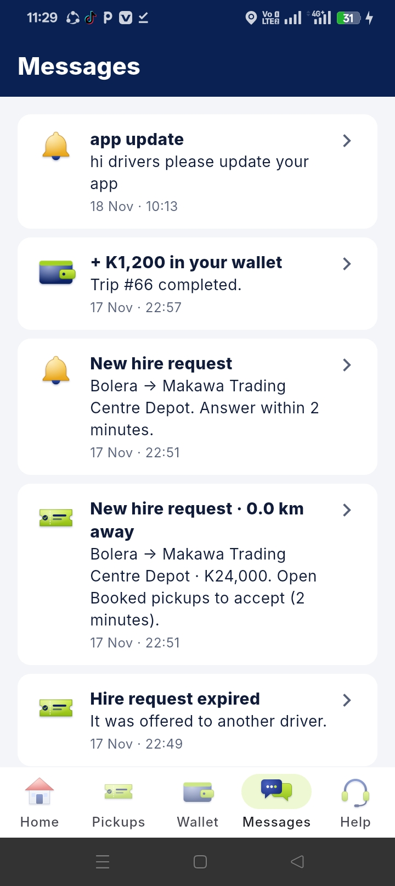
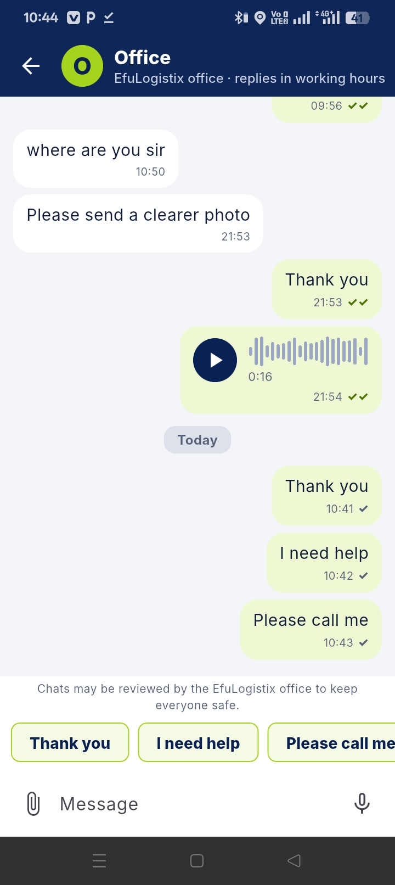
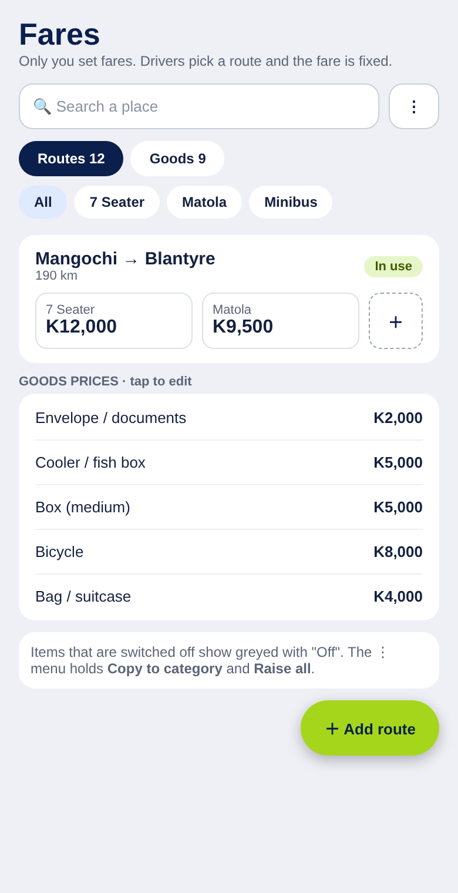
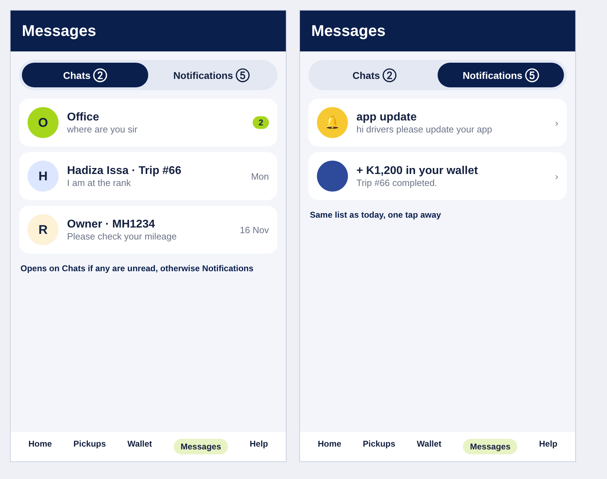
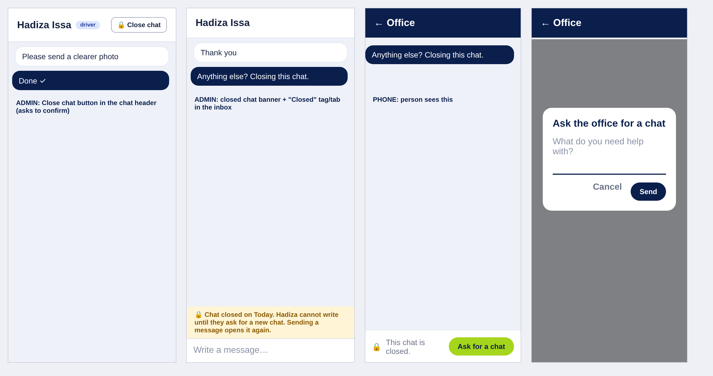
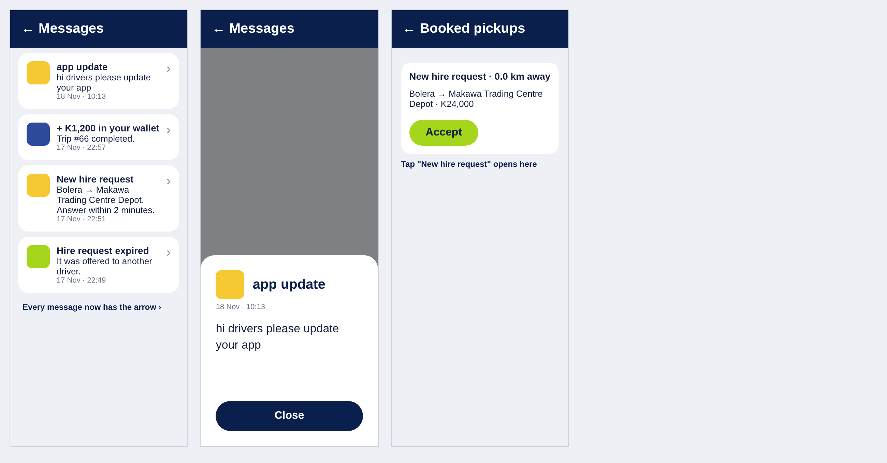

# EfuLogistix

Fleet and booking platform for matola (pickup truck) and minibus transport in Mangochi, Malawi. Passengers book seats, hire vehicles or send goods; drivers run shifts and trips; vehicle owners track their vehicles and money; the office runs everything from an admin panel.

Built solo, in Flutter and Supabase (Postgres), from the first screen to signed Android releases.

| | |
| --- | --- |
|  |  |

## What it does

- **Passengers:** book a seat on a route, hire a vehicle per km, or send a parcel with a collection code; follow the car live on a map; share the trip with family.
- **Drivers:** duty shifts, trips with stops, walk-in passengers, boarding by a 4-digit code, parcel hand-over, turn-by-turn navigation, offline GPS trail, wallet and cash hand-ins.
- **Owners:** live tracking of their own vehicles and drivers, cash confirmation, wallet payouts, service reminders.
- **Admin (web and Windows):** bookings and assigning vehicles (cars on the same route, nearby drivers for hire), fares and routes, people and vehicles, ratings, security alerts, office chat, broadcast messages.

## How it is built

| Folder | What |
| --- | --- |
| `phone/` | Phone app (Flutter, Android): passengers, drivers, owners |
| `admin/` | Admin panel (Flutter web and Windows) |
| `supabase/` | Database: Postgres schema, functions and tests (`schema_v*.sql`, `test/`) |
| `.github/workflows/` | Cloud builds (APK, admin web, Windows) and code checks |

(This showcase repo holds the README, screenshots and selected samples; the full source is private.)

Design choices worth a look:

- **Rules live in the database.** Trip steps, pricing, seat limits (a "7 Seater" carries 6 passengers) and money movements are Postgres functions with row-level security, not app code, and are covered by SQL test scripts in `supabase/test/`.
- **Fares, routes and settings are data,** so they change without a new app release.
- **Background tracking and push** use native Android code and Firebase Cloud Messaging; fake-GPS detection raises security alerts.
- **Mobile money** (Airtel Money, TNM Mpamba) with references, wallet and weekly payouts.
- **State:** one shared `AppState` (session, profile, truck) provided to the whole app with Provider and read with `Consumer`.
- **Simple driver screens:** large codes instead of QR scanning, clear status at every step.

## Design mockups

I draw each new screen first, then build it. These are the drawn mockups (not screenshots) for recent features:

| Admin Fares page on a phone | Driver Messages tab: chats and notifications |
| --- | --- |
|  |  |

| Office closes a chat, person asks for a new one | Every message can be opened |
| --- | --- |
|  |  |

## Code samples in this repo

The full source is private. These samples show how it is written:

- `samples/dart/`: formatting and parsing helpers used across the apps
- `samples/tests/`: unit tests (run in the cloud check on every change)
- `samples/sql/`: database updates: fake-GPS reporting, office chat close and reopen, seat rules
- `samples/ci/`: the GitHub Actions code check

## About me

Osman Foster, Flutter developer, Cape Town. Bachelor's degree in Information Systems.
GitHub: [fosterosman6-pixel](https://github.com/fosterosman6-pixel)
